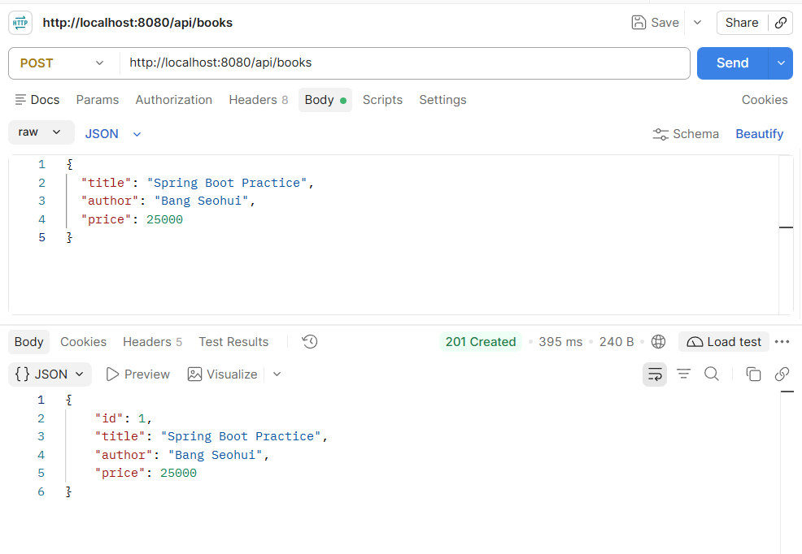
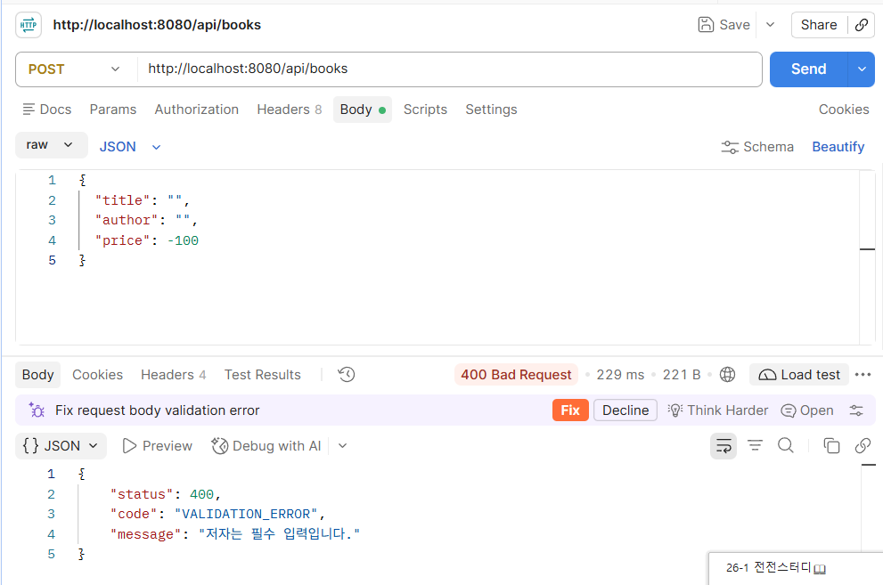
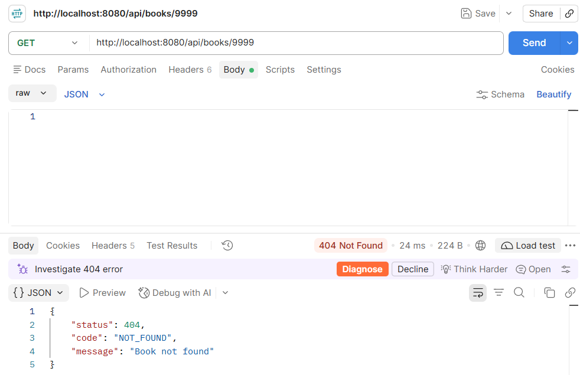
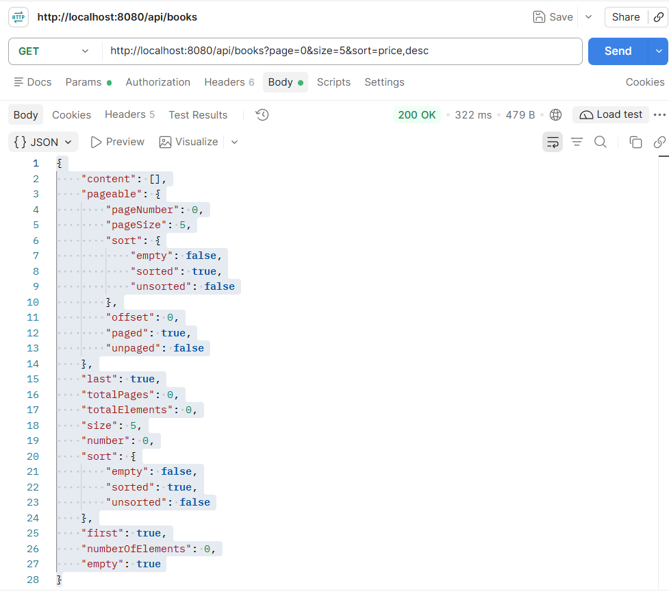
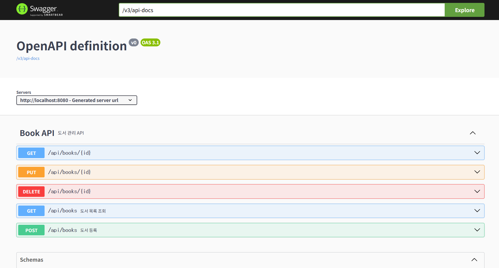

1. Project Information
GitHub URL :https://github.com/2026-2-WebService/assign12-c01-22500323.git
GitHub URL(개인) :https://github.com/22500323-cloud/week12_sample_project.git
Render URL : https://week12-sample-project-6hl3.onrender.com
2. Installation
3. Source Code Exploration
Project Structure & JPA
Q. BookController, BookService, BookRepository의 역할과 요청 처리 흐름을 설명하세요.
- BookController는 사용자의 요청을 받고 결과 반환, BookService는 실제 도서 관련 기능 처리, BookRepository는 데이터 베이스와 연결해 데이터를 저장
- BookController-> BookService-> BookRepository로 요청
Q. JpaRepository<Book, Long>만 선언해도 findAll(), save()를 사용할 수 있는 이유를 설명하세요.
- JpaRepository가 기본적인 데이터 저장, 조회, 수정, 삭제 기능을 제공하기 때문

DTO & HTTP Response
Q. 기존 API가 Book Entity를 직접 요청·응답에 사용할 때 발생할 수 있는 문제를 설명하세요.
- Entity를 직접 사용하면 데이터 베이스 구조가 API에 그대로 노출
- 필요한 정보만 전달하기 어렵고 변경되면 API에도 영향
Q. Request DTO와 Response DTO를 분리하는 이유와 ResponseEntity가 필요한 상황을 설명하세요.
- Request DTO는 사용자가 보내는 데이터를 받는 반면 Response DTO는 사용자에게 보여줄 데이터를 전달
- 분리하면 필요한 정보만 주고 받을 수 있음

Validation & Exception Handling
Q. @Valid, @NotBlank, @Min은 각각 어느 시점에 어떤 동작을 수행하나요?
- @Valid는 요청 데이터가 들어올 때 DTO의 검증 조건 확인 @NotBlank는 제목이나 저자가 비었는지 검사 @Min는 가격이 지정한 숫자보다 작은지 검사
Q. @RestControllerAdvice와 @ExceptionHandler를 사용하면 예외 처리 흐름이 어떻게 바뀌나요?
- 각 Controller에서 예외처리를 하지 않아도 공통적으로 할 수 있으ㅡㅁ

Pagination & OpenAPI
Q. Pageable과 Page<T>는 각각 어떤 역할을 하며 sort=price,desc는 어떻게 처리되나요?
- Pageable은 페이지 번호, 페이지 크기, 정렬 정보를 전달
- Page<T>는 조회된 데이터와 전체 페이지 수 같은 정보를 함께 반환
- sort=price,desc를 사용하면 가격이 높은 순서로 정렬
Q. /v3/api-docs와 /swagger-ui.html의 역할을 구분해서 설명하세요.
- /v3/api-docs는 API 정보를 JSON 형식으로 보여줌
- /swagger-ui.html은 API를 화면에서 확인하고 직접 테스트할 수 있는 페이지
4. Refactoring
- 기존에는 Book Entity를 Controller에서 직접 사용했지만 DTO를 적용하면서 요청과 응답을 분리
- 도서 등록과 수정에는 BookRequest를 사용
- 조회 결과는 BookResponse로 반환하도록 변경
- ResponseEntity를 사용해서 POST는 201, GET과 PUT은 200, DELETE는 204 상태 코드를 반환하도록 수정
5. New Features
- Validation
제목과 저자는 빈 값으로 입력할 수 없도록 설정
가격은 0 이상만 입력할 수 있도록 함
잘못된 요청은 400 오류를 반환
- 공통 예외 처리
존재하지 않는 도서 ID를 조회, 수정, 삭제하면 404 오류가 발생
GlobalExceptionHandler를 사용해서 오류 응답을 한 곳에서 처리
- Pagination / Sorting
Pageable을 사용해서 페이지 번호와 데이터 개수를 설정
가격을 기준으로 내림차순 정렬
- Swagger
Swagger UI에서 API 목록을 확인하고 직접 테스트
OpenAPI JSON으로 API 명세를 확인
@Tag와 @Operation을 사용해서 API 설명을 추가
Swagger 주소: https://week12-sample-project-6hl3.onrender.com/swagger-ui.html
6. Testing & Deployment

7. Weekly Review
- 새롭게 배운 내용
  (1)DTO를 사용해서 요청과 응답 데이터를 나누는 방법
  (2)Validation과 예외 처리를 이용해서 잘못된 요청을 처리하는 방법
  (3)Pageable을 이용한 페이지네이션과 Swagger 사용 방법
- 어려웠던 점과 해결방법 : Render 배포 과정에서 JAR 파일 경로가 맞지 않아 오류가 발생했지만 Dockerfile을 수정해서 해결
- AI활용 내용 및 느낀점 : ChatGPT를 이용해서 코드 오류를 확인하고 DTO, Validation, 페이지네이션, Swagger 구현 방법을 참고, AI가 알려준 내용을 직접 적용하고 실행하면서 기능을 이해하려고 함
